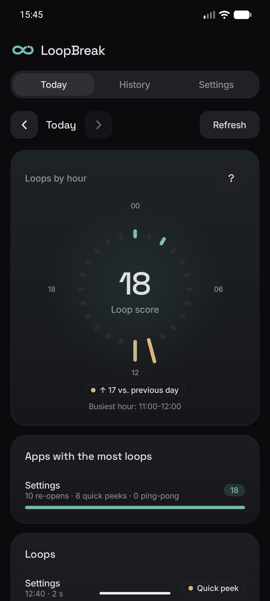
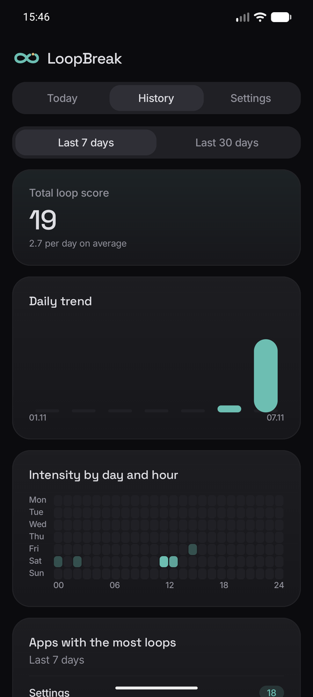
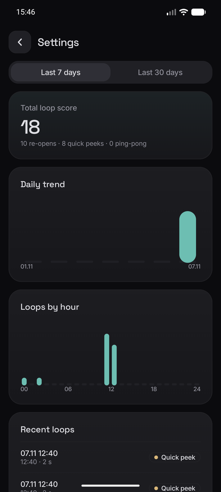
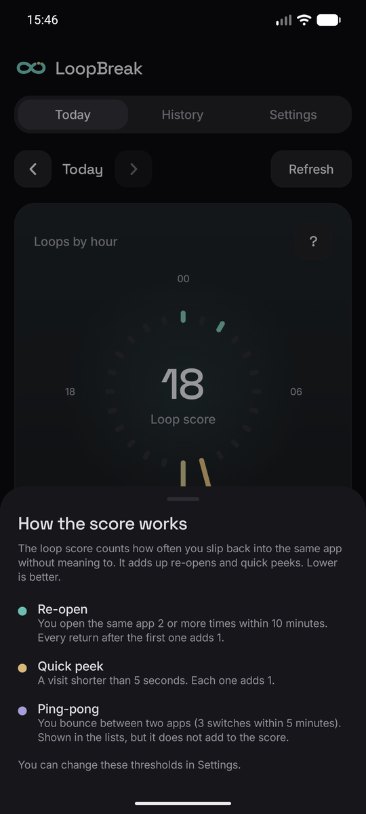
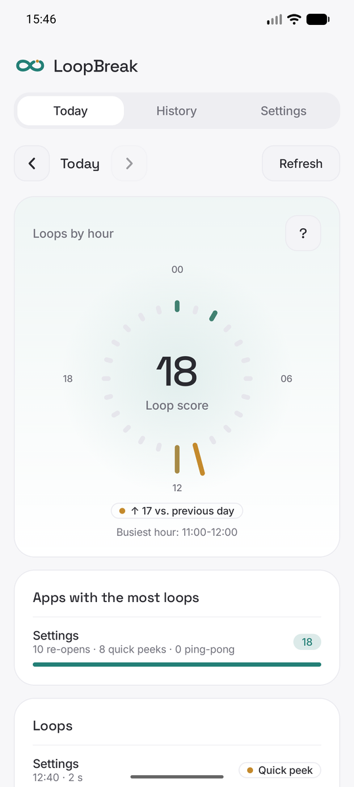
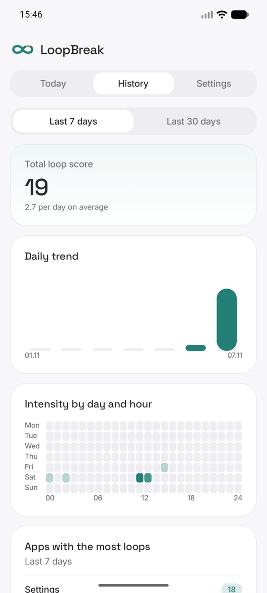
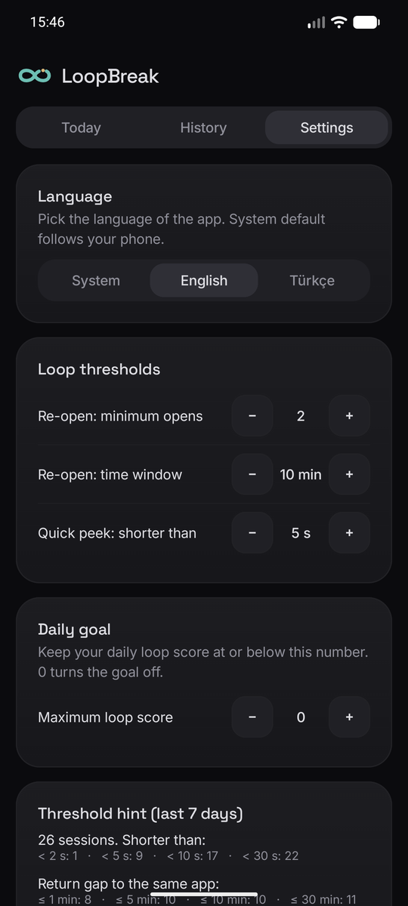
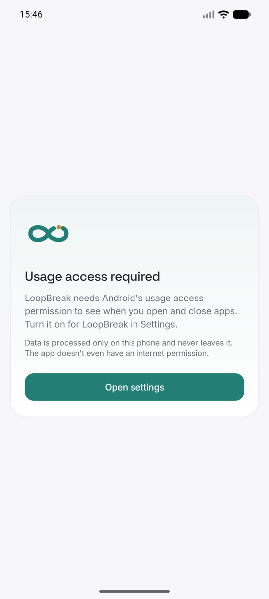

# LoopBreak

An Android app that makes the phone habits you repeat without noticing visible.

You open an app, close it, and open it again. You keep going back to the same social media feed. LoopBreak detects these **open-close loops** and shows them to you. The goal is not to restrict or shame you, only to help you notice the behaviour.

## The idea

Classic screen-time apps answer "how long did you use it?". LoopBreak answers "**how did you use it?**":

- Returning to the same app again and again within a short time (re-open)
- Very short reflex opens (quick peek)
- Bouncing back and forth between two apps (A → B → A → B, ping-pong)

Default thresholds, all adjustable in Settings:

| Loop | Default |
|---|---|
| Re-open | 2 or more opens of the same app within 10 minutes |
| Quick peek | A session shorter than 5 seconds |
| Ping-pong | 3 switches between two apps within 5 minutes |

## Screenshots

<table>
  <tr>
    <td align="center"><br><sub>Today</sub></td>
    <td align="center"><br><sub>History</sub></td>
    <td align="center"><br><sub>App detail</sub></td>
    <td align="center"><br><sub>Score explained</sub></td>
  </tr>
</table>

<table>
  <tr>
    <td align="center"><br><sub>Light theme</sub></td>
    <td align="center"><br><sub>Light theme</sub></td>
    <td align="center"><br><sub>Settings</sub></td>
    <td align="center"><br><sub>First launch</sub></td>
  </tr>
</table>

Captured on an emulator with demo data.

## Status

The UI is available in English and Turkish (follows the phone language by default; Settings has a language picker on Android 13+). The app is feature complete: permission onboarding, data collection, loop detection, Today / History / per-app detail / Settings screens, a comparison with the previous day, an optional daily goal with a streak, and two optional notifications (a gentle nudge and a weekly summary). It has been verified end to end on an Android emulator. What is left is calibrating the thresholds against several days of real phone usage (Settings shows the session-length and return-gap distribution to help with that). Publishing to the Play Store is out of scope for now.

## Tech stack

| Layer | Choice |
|---|---|
| Language | Kotlin |
| UI | Jetpack Compose + Material 3 |
| Data source | `UsageStatsManager.queryEvents()` |
| Background work | WorkManager (periodic sync) |
| Local database | Room |
| Settings | DataStore (Preferences) |
| Async | Coroutines + Flow |
| Navigation | Navigation Compose |
| Charts | Hand-drawn with Compose Canvas |
| Design | Clean card-based look in neutral tones with a teal brand colour, a 24-hour radial chart, Space Grotesk + Inter + JetBrains Mono bundled offline |
| DI | Hilt (`hilt-navigation-compose`, `hilt-work`) |
| Min SDK | 26 (Android 8.0) |

Detection logic lives in a pure Kotlin `domain` package with unit tests; it has no Android dependencies.

## Privacy

All data is processed and stored on the device and never leaves it. The app has no `INTERNET` permission and no analytics or third-party SDKs.

## Build and run

Requirements: Android Studio with the Android SDK (API 37 platform) and JDK 21.

1. Open the project in Android Studio and connect a phone with USB debugging enabled (or start an emulator).
2. Run the `app` configuration, or from a terminal:

```bash
./gradlew installDebug
```

3. On first launch the app explains why it needs **Usage access** and opens the system settings page. Grant it for LoopBreak and return to the app.

Useful commands:

```bash
./gradlew assembleDebug        # build a debug APK
./gradlew testDebugUnitTest    # run unit tests
./gradlew lintDebug            # run Android lint
```

## Fonts

Space Grotesk, Inter and JetBrains Mono are bundled as variable fonts (SIL Open Font License 1.1). Licenses are in [licenses/fonts](licenses/fonts).

## License

MIT, see [LICENSE](LICENSE). The bundled fonts have their own licenses (SIL OFL 1.1) in [licenses/fonts](licenses/fonts).

## Documentation

The documents below are written in Turkish.

- [docs/PRODUCT.md](docs/PRODUCT.md): product definition, user stories, loop definitions
- [docs/ARCHITECTURE.md](docs/ARCHITECTURE.md): architecture, data model, technology decisions
- [docs/ROADMAP.md](docs/ROADMAP.md): phases and progress
- [CLAUDE.md](CLAUDE.md): project notes for Claude Code
